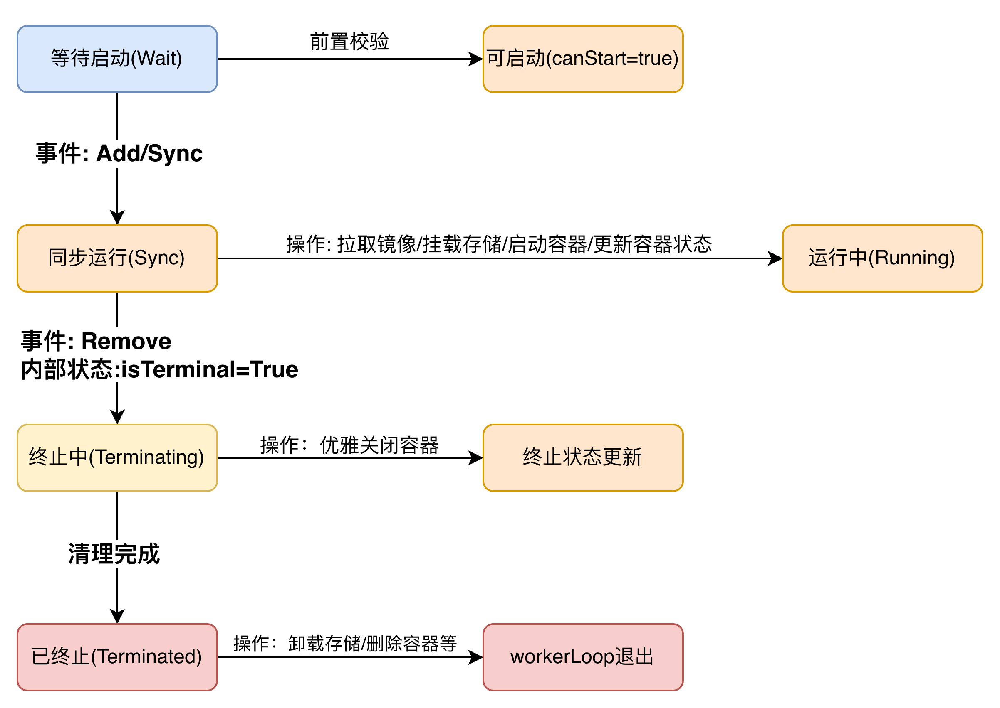
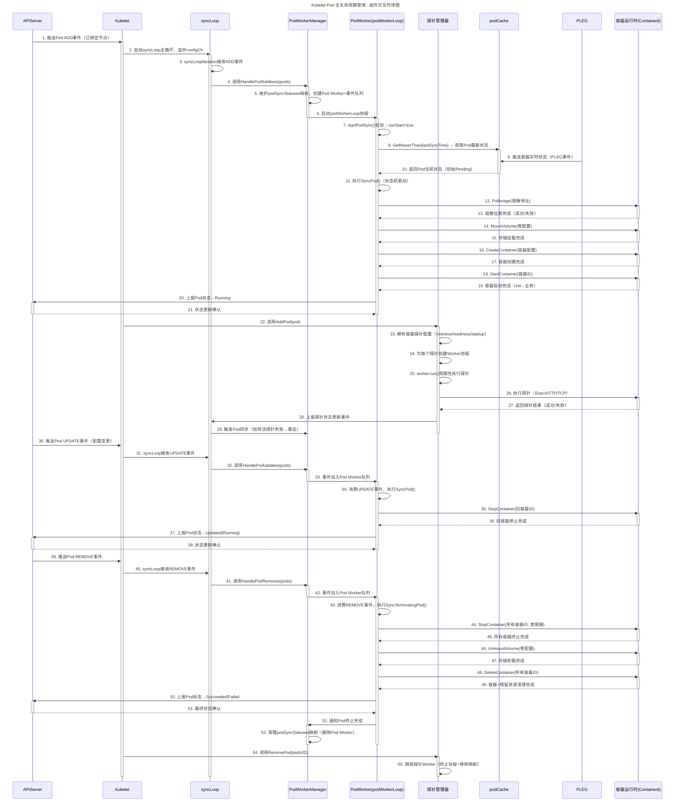

# Pod的生命周期

> 本文主要介绍kubelet如何通过`syncloop`和`podworker`管理Pod的生命周期，以及如何通过CRI接口与container runtime交互

## 概述
Kubernetes中的`Pod`是最小的调度单元，其生命周期由`kubelet`负责管理。`kubelet`通过内部的`syncloop`和`podworker`机制，结合`CRI（Container Runtime Interface）`与底层容器运行时（如containerd、CRI-O等）进行交互，实现对`Pod`的创建、更新、删除等操作。

## syncloop机制
`syncloop`是`kubelet`的主循环，负责周期性地同步节点上的`Pod`状态。其主循环流程如下：

1. 检查运行时错误（如容器运行时不可用）：有错误则退避等待，无错误则重置退避时间
2. 记录循环监控时间戳（用于健康检查）
3. 调用 `syncLoopIteration` 处理单次事件podworker
	- 配置更新事件`configCh`
		- 新增POD: 调用`HandlePodAdditions`接纳并启动Pod
		- 更新POD: 调用`HandlePodUpdates`同步更新后的配置
		- 移除POD: 调用`HandlePodRemoves`清理Pod
		- 调和POD(状态不一致): 调用`HandlePodReconcile`修复状态
		- 优雅删除POD: 按`UPDATE`处理（保证优雅关闭流程）
	- PLEG生命周期事件`plegCh`
		- 通过`isSyncPodWorthy(e)`判断事件是否需要触发 Pod 同步
		- 从`podManager`中查询事件对应的Pod，调用 `HandlePodSyncs`同步状态
		- 若事件为`ContainerDied`，触发容器清理（`cleanUpContainersInPod`）
	- 周期性同步事件`syncCh`
	  	> 由 syncTicker（1 秒周期）触发，兜底机制：
	  	- 调用`kl.getPodsToSync()`获取待同步的Pod列表
		- 调用`HandlePodSyncs`批量同步，确保无事件时也能维持状态一致
	- 健康检查事件`liveness/readiness/startup`
		- liveness: 失败则调用`handleProbeSync`标记为不健康，可能触发重启
		- readiness: 更新POD就绪状态`SetContainerReadiness`
		- startup: 更新POD启动状态`SetContainerStartup`
	- 周期性清理事件`housekeepingCh`
		> 周期性触发Pod清理任务（默认周期 `housekeepingPeriod=2s`）
		- 前置检查: 需所有配置源就绪（`sourcesReady.AllReady()`），避免误删未同步的Pod
		- 核心逻辑: 调用`HandlePodCleanups`清理无效Pod（如已删除但残留的容器、过期的镜像）
		- 监控: 若清理耗时超过 `housekeepingWarningDuration`，输出告警日志
4. 再次记录监控时间戳，完成一次迭代

## podworker机制

在Kubelet的`syncLoop`核心循环之下，PodWorker机制是负责将 Pod期望状态（如创建、更新、删除）落地为运行状态的关键组件。它本质是一套并行的Pod任务执行框架：每个Pod对应一个独立的Worker 协程，通过“事件队列 + 状态机”确保Pod操作的原子性、幂等性和有序性，避免并发操作冲突。其实现位于`pkg/kubelet/pod_workers.go`中

### 核心组件
- Pod Worker Manager（Worker 管理器）
	- 维护`podSyncStatuses`映射表
	- 接`syncLoop`分发的事件（如`HandlePodAdditions`），检查该Pod是否已存在Status
		- 不存在: 创建`podWorkerLoop`协程和channel，绑定到该Pod
		- 已存在: 缓存channel中写数据
	- Pod 被删除时
		- 关闭channel
		- 清理映射表
- Per Pod事件通道(`podUpdates = make(chan struct{}, 1)`)
- 维护Pod状态

### Kubelet Pod Worker 核心循环(podWorkerLoop)

`podWorkerLoop`是每个Pod专属 Worker 协程的核心执行逻辑，负责驱动Pod完整生命周期的状态流转（从启动到终止），严格遵循 “串行处理、状态机驱动、错误重试” 原则。它是Pod Worker机制的 “执行引擎”，直接对接容器运行时，将`syncLoop`分发的事件（ADD/UPDATE/REMOVE）落地为具体的 Pod操作。其核心流程如下:

1. 启动前检查: 调用`p.startPodSync(podUID)`做前置校验，确保操作合法性
	- 确保同一时刻只有一个Worker处理该Pod（通过podWorkers的锁机制）
	- 避免 “重复启动”（如已终止的 Pod 再次收到 ADD 事件）
2. 状态缓存刷新: 调用`p.podCache.GetNewerThan(update.Options.Pod.UID, lastSyncTime)`获取最新运行状态
	- 作用: 从`podCache`（基于 PLEG 事件更新）获取比上一次同步时间（`lastSyncTime`）更新的Pod状态（`kubecontainer.PodStatus`），包含容器列表、容器状态（运行 / 退出）、退出码等
	- 异常处理: 若获取状态失败（如缓存未就绪），记录Warning事件（`FailedSync`）并返回错误，触发后续重试
	- 特殊场景: 若操作类型是 “终止运行时 Pod”（`RunningPod != nil`），无需获取状态，直接执行终止操作（因运行时已明确Pod存在）
3. 阶段化操作执行: 根据workType操作类型进入不同阶段(状态机)
	- 同步运行阶段
	- 终止中阶段
	- 以终止阶段
4. 错误处理和状态流转
5. 重试与阶段流转调度

## 生命周期事件

### POD阶段

`Pod`的生命周期主要包括以下几个阶段：
- `Pending`: Pod 已被 Kubernetes 集群接受，但一个或多个容器尚未设置并准备运行
- `Running`: Pod 已被绑定到节点，并且所有容器都已创建。至少一个容器仍在运行，或者正在启动或重启过程中
- `Succeeded`: Pod 中的所有容器都已成功终止，并且不会被重启
- `Failed`: Pod 中的所有容器都已终止，并且至少有一个容器终止失败
- `Unknown`：由于某种原因无法获取 Pod 的状态。此阶段通常是由于与 Pod 应该运行的节点通信时出错而发生的。

### 容器状态
除了 Pod 的整体阶段之外，Kubernetes 还跟踪 Pod 中每个容器的状态。你可以使用容器生命周期钩子来触发事件，使其在容器生命周期中的特定点运行。
一旦调度器将Pod分配给一个节点，kubelet就会使用容器运行时为该Pod创建容器。容器有三种可能的状态：`Waiting`、`Running`和`Terminated`。

- `Waiting`: 如果容器既不在`Running`状态也不在`Terminated`状态，则它处于`Waiting`状态
- `Running`: `Running`状态表示容器正在执行而没有问题
- `Terminated`: 处于`Terminated`状态的容器已经开始执行，然后要么运行完成，要么因某种原因失败

## 交互流程示意图

