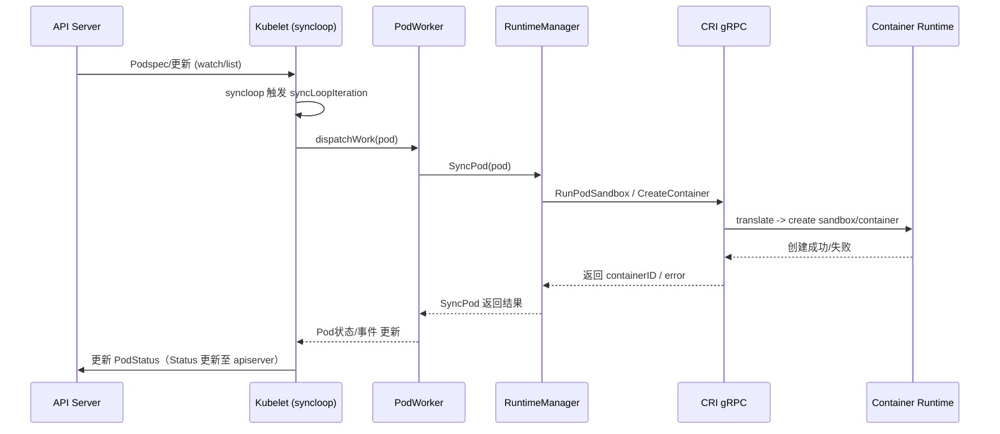

# Pod的生命周期

> 本文主要介绍kubelet如何通过`syncloop`和`podworker`管理Pod的生命周期，以及如何通过CRI接口与container runtime交互

# 概述
Kubernetes中的`Pod`是最小的调度单元，其生命周期由`kubelet`负责管理。`kubelet`通过内部的`syncloop`和`podworker`机制，结合`CRI（Container Runtime Interface）`与底层容器运行时（如containerd、CRI-O等）进行交互，实现对`Pod`的创建、更新、删除等操作。

## syncloop机制
`syncloop`是`kubelet`的主循环，负责周期性地同步节点上的`Pod`状态。其主要流程如下：
- 定期从apiserver拉取期望的Pod列表（desired state）。
- 获取当前节点上实际运行的Pod状态（actual state）。
- 对比期望状态与实际状态，找出需要创建、更新或删除的 Pod。
- 将需要处理的Pod任务分发给 podworker。

`syncloop`的核心作用是保证节点上的`Pod`状态与`apiserver`中的期望状态一致。

## podworker机制
`podworker`是`kubelet`中用于并发处理`Pod`任务的工作线程。每个`Pod`都会分配一个`podworker`，负责具体的生命周期管理，包括：
- Pod的创建：拉取镜像、创建容器、设置网络等。
- Pod的更新：如容器重启、配置变更等。
- Pod的删除：优雅终止容器、清理资源等。

`podworker`通过队列机制，确保同一个`Pod`的操作串行执行，避免并发冲突。

## CRI接口与容器运行时交互
`kubelet`并不直接操作容器运行时，而是通过`CRI（Container Runtime Interface）`进行标准化的调用。主要流程如下：
- `kubelet`通过gRPC调用`CRI`接口（如RunPodSandbox、CreateContainer、StartContainer、StopContainer、RemovePodSandbox等）。
- `CRI`实现（如containerd-shim、cri-o）负责将这些请求转化为底层容器运行时的具体操作。
- 容器运行时完成实际的容器管理任务，并将结果返回给 kubelet。

通过`CRI`，`kubelet`可以支持多种容器运行时，提升了系统的可扩展性和灵活性。

## 生命周期事件
`Pod`的生命周期主要包括以下几个阶段：
- `Pending`：等待调度和资源分配。
- `Running`：容器已启动并正常运行。
- `Succeeded/Failed`：容器终止，`Pod`进入完成或失败状态。
- `Terminating`：`Pod`被删除，`kubelet`负责优雅终止容器。

`kubelet`通过`syncloop`检测状态变化，并由`podworker`具体执行生命周期事件，最终通过`CRI`与容器运行时完成实际操作。

## 具体源码流程与交互细节

### 1. syncloop主循环源码流程

kubelet的syncloop主循环在`pkg/kubelet/kubelet.go`的`StartSyncLoop`方法中实现。其核心逻辑如下：

1. 定期监听apiserver的Pod更新事件（通过watch或list）。
2. 触发 `syncLoopIteration`，对比期望状态与实际状态。
3. 调用 `dispatchWork`，将需要处理的Pod任务分发给podworker。

关键源码片段：

```go
func (kl *Kubelet) StartSyncLoop(updates <-chan kubetypes.PodUpdate, handler SyncHandler, ...) {
	for {
		select {
		case update := <-updates:
			kl.syncLoopIteration(update, handler, ...)
		}
	}
}
```

### 2. podworker任务分发与执行流程

podworker的实现位于`pkg/kubelet/pod_workers.go`。每个Pod都有一个独立的worker，确保串行处理。主要流程：

1. `dispatchWork`将Pod任务加入podWorkers的队列。
2. podworker 通过`managePodLoop`方法循环处理任务。
3. 根据Pod状态调用`SyncPod`，执行具体的创建、更新、删除操作。

关键源码片段：

```go
func (p *podWorkers) UpdatePod(...) {
	// 将任务加入队列
	go p.managePodLoop(...)
}

func (p *podWorkers) managePodLoop(...) {
	for {
		// 处理队列中的Pod任务
		p.syncPodFn(...)
	}
}
```

### 3. kubelet与CRI的交互流程

kubelet通过CRI gRPC接口与容器运行时通信，相关代码在`pkg/kubelet/kuberuntime/kuberuntime_manager.go`。主要流程：

1. 创建Pod时，调用`RunPodSandbox`创建沙箱容器。
2. 创建业务容器，调用`CreateContainer`和`StartContainer`。
3. 删除Pod时，调用`StopContainer`和`RemovePodSandbox`。

关键源码片段：

```go
// 创建Pod沙箱
resp, err := m.runtimeService.RunPodSandbox(podSandboxConfig, runtimeHandler)

// 创建容器
containerID, err := m.runtimeService.CreateContainer(podSandboxID, containerConfig, podSandboxConfig)

// 启动容器
err := m.runtimeService.StartContainer(containerID)
```

CRI接口定义在`pkg/kubelet/remote/remote_runtime.go`，通过gRPC与containerd/cri-o等runtime 通信。

### 4. 生命周期事件的源码追踪

Pod的每个生命周期事件（如创建、删除）最终都会调用`SyncPod`方法，该方法会根据Pod的期望状态与实际状态，决定调用哪些CRI接口。

```go
func (m *kubeGenericRuntimeManager) SyncPod(...) {
	// 判断需要创建、更新或删除容器
	// 调用 CRI 接口完成实际操作
}
```

### 5. 交互流程示意图

#### 5.1 时序图

