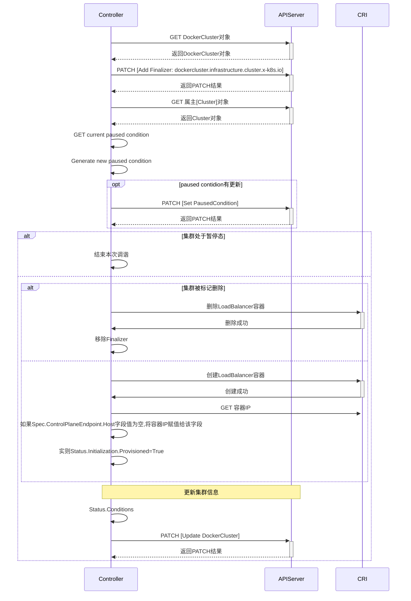
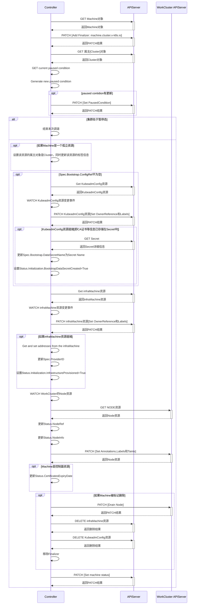
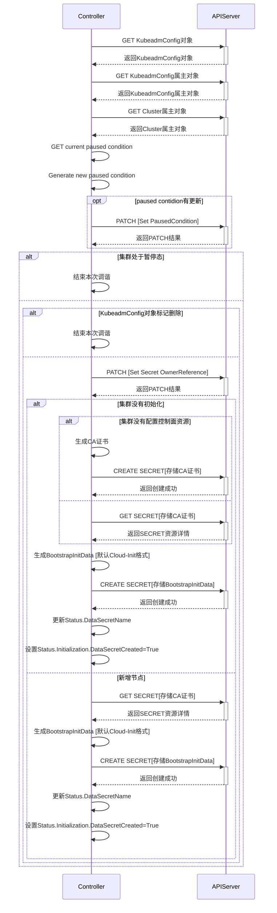
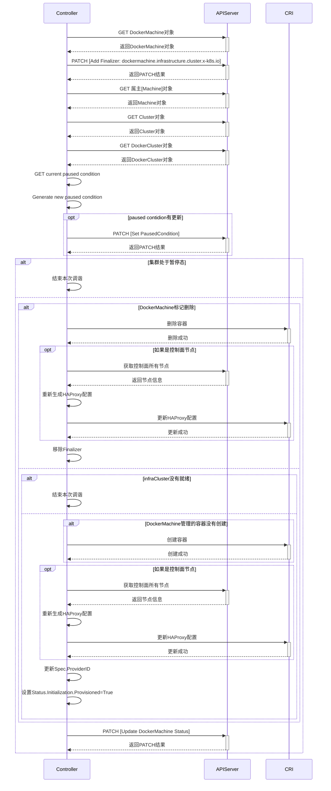

# 基于Cluster Api的kubernetes集群生命周期管理
> <span style="color:red;"><b>NOTE:</b></span> 本文基于[v1.11.2](https://github.com/kubernetes-sigs/cluster-api/tree/v1.11.2)版本

## Cluster API
[Cluster API(CAPI)](https://cluster-api.sigs.k8s.io/)是一个Kubernetes声明式API风格的多kubernetes集群生命周期管理项目. CAPI的目标是简化kubernetes LCM,使得LCM自动化,并支持不同的Iaas

**架构图**


- **Cluster API**: 集群的基础管理工作、Worker节点的生命周期管理、协调Provider完成集群LCM工作
- **Infrastructure Provider**: 管理集群所需要的基础设施资源,例如虚拟机、网络等
- **Bootstrap Provider**: 管理集群节点(生成证书、初始化控制面等)
- **Control plane Provider**: 控制面节点管理工作

## 工作流程

### 核心概念和控制器分工
CAPI采用“分层设计”，将集群管理拆分为多个独立资源和对应的控制器，各司其职又协同工作。核心资源及控制器包括：
| 资源类型 | 控制器代码 | 核心功能 |
| :--- | :--- | :--- |
|  `Cluster` | [cluster_controll](https://github.com/kubernetes-sigs/cluster-api/blob/v1.11.2/internal/controllers/cluster/cluster_controller.go) | 管理集群生命周期,协调基础设施和控制平面的依赖关系 |
| `KubeadmControlPlane` | [kcp_controller](https://github.com/kubernetes-sigs/cluster-api/blob/v1.11.2/controlplane/kubeadm/internal/controllers/controller.go) | 管理控制平面节点的创建、升级和修复. 基于`kubeadm`配置控制平面组件 |
| `Machine` | [machine_controller](https://github.com/kubernetes-sigs/cluster-api/blob/v1.11.2/internal/controllers/machine/machine_controller.go) | 管理单个节点的生命周期,对接底层基础设施的创建和删除. 类似于`Pod` |
| `MachineSet` | [machine_set_controller](https://github.com/kubernetes-sigs/cluster-api/blob/v1.11.2/internal/controllers/machineset/machineset_controller.go) | 类似于`ReplicaSet` |
| `MachineDeployment` | [machinedeployment_controller](https://github.com/kubernetes-sigs/cluster-api/blob/v1.11.2/internal/controllers/machinedeployment/machinedeployment_controller.go) | 类似于`Deployment`,通过`MachineSet`管理节点的扩缩容 |
| 基础设施资源(如:`DockerMachine`) | [dockermachine_controller](https://github.com/kubernetes-sigs/cluster-api/blob/v1.11.2/test/infrastructure/docker/internal/controllers/dockermachine_controller.go) | 实际机器的创建/删除操作 |

### 集群创建流程
> 创建一个基于Docker的本地集群为例

**初始化Infra**
```shell
# 使用docker provider
clusterctl init --infrastructure docker
```

**集群创建流程**

1. 创建集群`Cluster`
```yaml
apiVersion: cluster.x-k8s.io/v1beta2
kind: Cluster
metadata:
  name: capi-quickstart
spec:
  clusterNetwork:
    pods:
      cidrBlocks:
      - 192.168.0.0/16
    serviceDomain: cluster.local
    services:
      cidrBlocks:
      - 10.128.0.0/12
  controlPlaneRef:
    apiGroup: controlplane.cluster.x-k8s.io
    kind: KubeadmControlPlane
    name: quickstart-control-plane
  infrastructureRef:
    apiGroup: infrastructure.cluster.x-k8s.io
    kind: DockerCluster
    name: quick-start-cluster
```



```mermaid
sequenceDiagram
  Controller->> +APIServer: GET Cluster对象
  APIServer-->> -Controller: 返回Cluster对象

  Controller->> +APIServer: PATCH [Add Finalizer: cluster.cluster.x-k8s.io]
  APIServer-->> -Controller: 返回PATCH结果

  Controller->> Controller: GET current paused condition
  Controller->> Controller: Generate new paused condition
  opt paused contidion有更新
    Controller->> +APIServer: PATCH [Set PausedCondition]
    APIServer-->> -Controller: 返回PATCH结果
  end

  alt 集群处于暂停态
    Controller->> Controller: 结束本次调谐
  else
    opt 集群定义拓扑
      Controller->> +APIServer: GET ClusterClass对象
      APIServer-->> -Controller: 返回ClusterClass对象
    end

    Note over Controller,APIServer: 调谐Infrastructure Cluster,例如:DockerCluster
    alt Spec.InfrastructureRef没有定义且集群未删除
      Controller->> Controller: 设置Status.Initialization.InfrastructureProvisioned为True
    else
      Controller->> +APIServer: GET infraCluster对象
      APIServer-->> -Controller: 返回infraCluster对象
      Controller->> Controller: WATCH infraCluster对象变更事件
      Controller->> +APIServer: PATCH infraCluster对象[Set OwnerReference和Labels]
      APIServer-->> -Controller: 返回PATCH结果

      opt infraCluster集群已就绪
        Controller->> Controller: Set Spec.ControlPlaneEndpoint
        Controller->> Controller: Set Status.Initialization.InfrastructureProvisioned=True
      end
    end

    Note over Controller,APIServer: 调谐ControlPlane,例如:KubeadmControlPlane
    opt Spec.ControlPlaneRef已定义
      Controller->> +APIServer: GET controlPlane对象
      APIServer-->> -Controller: 返回controlPlane对象
      Controller->> Controller: WATCH controlPlane对象变更事件
      Controller->> +APIServer: PATCH controlPlane对象[Set OwnerReference和Labels]
      APIServer-->> -Controller: 返回PATCH结果

      opt 控制面已就绪
        Controller->> Controller: Set Spec.ControlPlaneEndpoint
        Controller->> Controller: Set Status.Initialization.ControlPlaneInitialized=True
      end
    end

    Note over Controller,APIServer: 收集集群依赖资源
    Controller->> Controller: List MachineDeployment
    Controller->> Controller: List MachineSet
    Controller->> Controller: List Machine

    Note over Controller,APIServer: 集群删除前的清理逻辑
    opt 集群被标记删除
      Controller->> Controller: 过滤集群所属的资源列表(MachineDeploymnet,MachineSet等)
      opt 集群子资源列表不为空
        loop: 删除集群所属资源
          Controller->> +APIServer: 删除集群子资源
          APIServer-->> -Controller: 返回删除结果
        end
      end
      Controller->> +APIServer: 删除集群控制面资源
      APIServer-->> -Controller: 返回删除结果
      Controller->> +APIServer: 删除infraCluster资源
      APIServer-->> -Controller: 返回删除结果
      Controller->>Controller: 移除Finalizer
    end

    Note over Controller,APIServer: 更新集群信息
    Controller->> Controller: Set Status.Phase
    Controller->> Controller: Status.ControlPlane
    Controller->> Controller: Status.Workers
    Controller->> Controller: Status.Conditions
    Controller->> +APIServer: PATCH [Update Cluster]
    APIServer-->> -Controller: 返回PATCH结果
  end
```

2. 创建集群基础设施`DockerCluster`
```yaml
apiVersion: infrastructure.cluster.x-k8s.io/v1beta2
kind: DockerCluster
metadata:
  name: quick-start-cluster
  namespace: default
spec: {}
```



3. 创建控制面节点模板`DockerMachineTemplate`
```yaml
apiVersion: infrastructure.cluster.x-k8s.io/v1beta2
kind: DockerMachineTemplate
metadata:
  name: quickstart-control-plane-template
spec:
  template:
    spec: {}
```

4. 创建控制面`KubeadmControlPlane`
```yaml
apiVersion: controlplane.cluster.x-k8s.io/v1beta2
kind: KubeadmControlPlane
metadata:
  name: quickstart-control-plane
spec:
  replicas: 1
  version: v1.28.13
  machineTemplate:
    spec:
      infrastructureRef:
        apiGroup: infrastructure.cluster.x-k8s.io
        kind: DockerMachineTemplate
        name: quickstart-control-plane-template
  kubeadmConfigSpec:
    clusterConfiguration:
      apiServer:
        certSANs:
        - localhost
        - 127.0.0.1
        - 0.0.0.0
        - host.docker.internal
    initConfiguration:
      nodeRegistration:
        kubeletExtraArgs:
        - name: eviction-hard
          value: nodefs.available<0%,nodefs.inodesFree<0%,imagefs.available<0%
    joinConfiguration:
      nodeRegistration:
        kubeletExtraArgs:
        - name: eviction-hard
          value: nodefs.available<0%,nodefs.inodesFree<0%,imagefs.available<0%
```



```mermaid
sequenceDiagram
  Controller->> +APIServer: GET KubeadmControlPlane对象
  APIServer-->> -Controller: 返回KubeadmControlPlane对象

  Controller->> +APIServer: PATCH [Add Finalizer: kubeadm.controlplane.cluster.x-k8s.io]
  APIServer-->> -Controller: 返回PATCH结果

  Controller->> +APIServer: GET 属主[Cluster]对象
  APIServer-->> -Controller: 返回Cluster对象

  Controller->> Controller: GET current paused condition
  Controller->> Controller: Generate new paused condition
  opt paused contidion有更新
    Controller->> +APIServer: PATCH [Set PausedCondition]
    APIServer-->> -Controller: 返回PATCH结果
  end

  alt 集群处于暂停态
    Controller->> Controller: 结束本次调谐
  else
    Note over Controller,APIServer: Initialize the control plane scope
    alt infraCluster资源未就绪
      Controller->> Controller: 结束本次调谐
    end

    Controller->> +APIServer: LIST 控制面机器列表
    APIServer-->> -Controller: 返回机器列表

    Controller->> Controller: 过滤孤立的控制面节点
    Controller->> Controller: 过滤当前控制面资源管理的节点资源

    alt 存在孤立的控制面节点
      Controller->> Controller: 结束本次调谐
    else
      alt 控制面资源被标记删除
        alt 控制面节点数为零
          Controller->> Controller: 移除Finalizer
        else
          Controller->> +APIServer: LIST 集群节点列表
          APIServer-->> -Controller: 返回节点列表
          alt 集群中存在数据面节点或存在节点池
            Controller->> Controller: 结束本次调谐,进入延迟队列,待下一次调谐
          else
            Controller->> +APIServer: PATCH [删除节点的preTerminalHook annotation]
            APIServer-->> -Controller: 返回PATCH结果

            Controller->> +APIServer: DELETE [删除节点]
            APIServer-->> -Controller: 返回删除结果
          end
        end
      else
        Controller->> +APIServer: GET Spec.MachineTemplate.Spec.InfrastructureRef定义的资源
        APIServer-->> -Controller: 返回资源信息
        Controller ->> Controller: 设置OwnerReference
        Controller->> +APIServer: PATCH [Set OwnerReference]
        APIServer-->> -Controller: 返回PATCH结果

        Controller ->> Controller: 生成集群CA证书
        Controller->> +APIServer: CREATE [证书存储在Secret中]
        APIServer-->> -Controller: 返回创建结果

        Controller ->> Controller: 生成Kubeconfig
        Controller->> +APIServer: CREATE [Kubeconfig存储在Secret中]
        APIServer-->> -Controller: 返回创建结果

        Controller ->> +APIServer: syncMachines[当前存在的控制面节点,更新kubeconfig,Spec.Deletion等信息]
        APIServer-->> -Controller: 返回更新结果

        Controller ->> Controller: 更新控制面和节点的Condition

        opt 如果etcd集群被KCP托管
          loop 遍历etcd节点
            opt etcd节点没有对应的node节点
              Controller ->> +ETCD: 删除该节点
              ETCD ->> -Controller: 删除完成
            end
          end
        end

        Note over Controller,APIServer: 调谐即将删除的控制面节点
        opt 控制面节点大于1且etcd集群被KCP托管
          Controller ->> +ETCD: 删除该节点
          ETCD -->> -Controller: 删除完成
        end
        Controller ->> +APIServer: PATCH [删除PreTerminateHookAnnotation]
        APIServer -->> -Controller: 返回PATCH结果

        Note over Controller,APIServer: 调谐不健康的节点
        Controller ->> Controller: 协调不健康节点

        alt 如果需要升级控制面
          Controller ->> Controller: upgradeControlPlane控制面升级
        else 控制面节点数为零
          Controller ->> +APIServer: 基于Spec.MachineTemplate.Spec.InfrastructureRef管理的资源创建infraMachine
          APIServer -->> -Controller: 返回创建结果
          Controller ->> +APIServer: 创建KubeadmConfig
          APIServer -->> -Controller: 返回创建结果
          Controller ->> +APIServer: 创建Machine
          APIServer -->> -Controller: 返回创建结果
        else 控制面节点不为零但小于期望节点数
          opt 集群处于稳态
            Controller ->> +APIServer: 基于Spec.MachineTemplate.Spec.InfrastructureRef管理的资源创建infraMachine
            APIServer -->> -Controller: 返回创建结果
            Controller ->> +APIServer: 创建KubeadmConfig
            APIServer -->> -Controller: 返回创建结果
            Controller ->> +APIServer: 创建Machine
            APIServer -->> -Controller: 返回创建结果
          end
        else
          opt 集群处于稳态
            opt KCP托管etcd
              Controller ->> +ETCD: 转移etcd leader
              ETCD -->> -Controller: 转移完成
            end
            Controller ->> +APIServer: DELETE节点
            APIServer -->> -Controller: 返回删除结果
          end
        end
      end
    end

    Note over Controller,APIServer: 更新集群信息
    Controller->> Controller: Status.Conditions
    Controller->> +APIServer: PATCH [Update DockerCluster]
    APIServer-->> -Controller: 返回PATCH结果
  end
```

5. 控制面节点`Machine`
> `KubeadmControlPlane`控制器已经创建了`Machine`资源



6. BootStrap Provider(`KubeadmConfig`)生成Secret



7. infrastructure Provider(`DockerMachine`)创建物理节点



### 集群升级流程
> <span style="color:red;"><b>NOTE:</b></span> 升级需遵循Kubernetes版本升级规则(如从 v1.28 → v1.29，不支持跨多个次要版本跳跃升级)

**升级前提**
- 管理集群就绪: CAPI核心组件（cluster-api-controller-manager等）运行正常，版本支持目标Kubernetes版本
- 目标集群状态
  - 集群处于Ready状态
  - 所有节点处于Ready状态
- 备份: 建议备份管理集群中与目标集群相关的资源（`Cluster`、`KubeadmControlPlane`、`MachineDeployment`等），以及目标集群的关键数据

**升级控制面**
- 查看当前版本
```shell
kubectl get kubeadmcontrolplanes.controlplane.cluster.x-k8s.io quickstart-control-plane  -ojsonpath='{.spec.version}'
```

- 更新版本
```shell
kubectl patch kubeadmcontrolplane quickstart-control-plane --type merge -p '{"spec": {"version": "v1.29.10"}}'
```

- 查看升级进度
```shell
kubectl get kubeadmcontrolplane quickstart-control-plane -w
```

**升级数据面**
- 更新版本
```shell
# 数据面和控制面版本必须保持一致
kubectl patch machinedeployment <md-name> --type merge -p '{"spec": {"template": {"spec": {"version": "v1.29.10"}}}}'
```

**检查集群状态**
```shell
# 获取admin kubeconfig
kubectl get secret capi-quickstart-kubeconfig -o jsonpath='{.data.value}' | base64 -d > workload-kubeconfig.yaml
# 查看节点版本
kubectl --kubeconfig=workload-kubeconfig.yaml get nodes
# 确认目标集群的核心组件(kube-apiserver、kubelet)运行正常
kubectl --kubeconfig=workload-kubeconfig.yaml get pods -n kube-system
```
