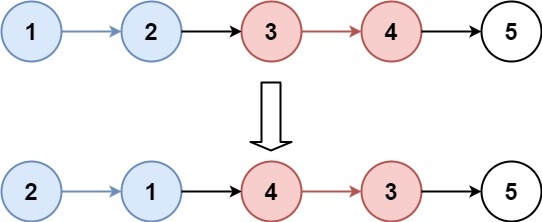
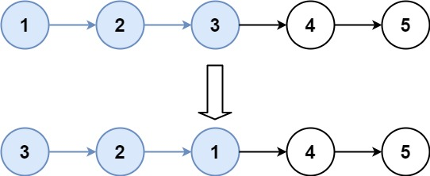
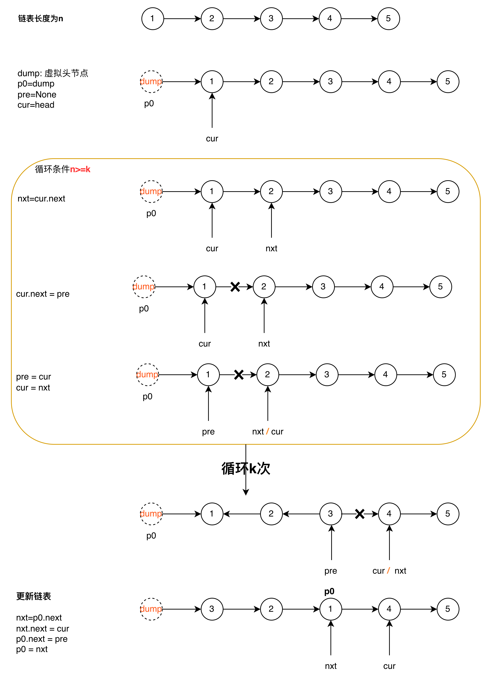

# k个一组翻转链表
> https://leetcode.cn/problems/reverse-nodes-in-k-group/description/

给你链表的头节点`head`，每`k`个节点一组进行翻转，请你返回修改后的链表。

`k`是一个正整数，它的值小于或等于链表的长度。如果节点总数不是`k`的整数倍，那么请将最后剩余的节点保持原有顺序。
你不能只是单纯的改变节点内部的值，而是需要实际进行节点交换。


**示例1**

```
输入：head = [1,2,3,4,5], k = 2
输出：[2,1,4,3,5]
```

**示例2**

```
输入：head = [1,2,3,4,5], k = 3
输出：[3,2,1,4,5]
```

**提示**
- 链表中的节点数目为`n`
- `1 <= k <= n <= 5000`
- `0 <= Node.val <= 1000`





```python3
# Definition for singly-linked list.
# class ListNode:
#     def __init__(self, val=0, next=None):
#         self.val = val
#         self.next = next
class Solution:
    def reverseKGroup(self, head: ListNode, k: int) -> ListNode:
        dump = ListNode(next=head)
        p0 = dump
        n = 0
        cur = head
        while cur:
            n += 1
            cur = cur.next

        cur = head
        pre = None
        while n >= k:
            n -= k
            for _ in range(k):
                nxt = cur.next
                cur.next = pre
                pre = cur
                cur = nxt

            nxt = p0.next
            nxt.next = cur
            p0.next = pre
            p0 = nxt
        return dump.next
```