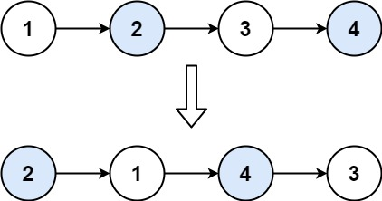

# 两两交换链表中的节点
> https://leetcode.cn/problems/swap-nodes-in-pairs/description/

给你一个链表，两两交换其中相邻的节点，并返回交换后链表的头节点。你必须在不修改节点内部的值的情况下完成本题（即，只能进行节点交换）。

**示例1**

```
输入：head = [1,2,3,4]
输出：[2,1,4,3]
```

**示例2**
```
输入：head = []
输出：[]
```

**示例3**
```
输入：head = [1]
输出：[1]
```

**提示**
- 链表中节点的数目在范围`[0, 100]`内
- `0 <= Node.val <= 100`


**题解**
创建哨兵节点`dummp_head`，用`node0`表示`dummp_head`, `node1`表示第一个节点，以此类推
- `node0`指向`node2`
- `node2`指向`node1`
- `node1`指向`node3`
- 更新`node0`为`node1`, `node1`为`node3`
- 如果`node1`和`node1.next`都不为空，则回到第一步再次交换节点
- 最后返回`dummp_head.next`作为头节点


```python3
# Definition for singly-linked list.
# class ListNode:
#     def __init__(self, val=0, next=None):
#         self.val = val
#         self.next = next
class Solution:
    def swapPairs(self, head: Optional[ListNode]) -> Optional[ListNode]:
        dummp_head = ListNode(next=head)

        node1 = head
        node0 = dummp_head
        while node1 and node1.next:
            node2 = node1.next
            node3 = node2.next

            node0.next = node2
            node2.next = node1
            node1.next = node3

            node0 = node1
            node1 = node3


        return dummp_head.next
```