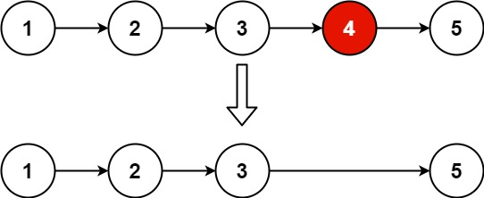

# 删除链表的倒数第N个节点
> https://leetcode.cn/problems/remove-nth-node-from-end-of-list/description/

给你一个链表，删除链表的倒数第`n`个结点，并且返回链表的头结点。

**示例1**

```
输入：head = [1,2,3,4,5], n = 2
输出：[1,2,3,5]
```

**示例2**
```
输入：head = [1], n = 1
输出：[]
```

**示例3**
```
输入：head = [1,2], n = 1
输出：[1]
```

**提示**
- 链表中结点的数目为`sz`
- `1 <= sz <= 30`
- `0 <= Node.val <= 100`
- `1 <= n <= sz`


```python3
# Definition for singly-linked list.
# class ListNode:
#     def __init__(self, val=0, next=None):
#         self.val = val
#         self.next = next
class Solution:
    def removeNthFromEnd(self, head: Optional[ListNode], n: int) -> Optional[ListNode]:
        dummp_head = head

        cur = head
        while n and cur:
            n -= 1
            cur = cur.next
        # n等于链表长度
        if not cur:
            return dummp_head.next
        while cur.next:
            cur = cur.next
            head = head.next
        head.next = head.next.next

        return dummp_head
```