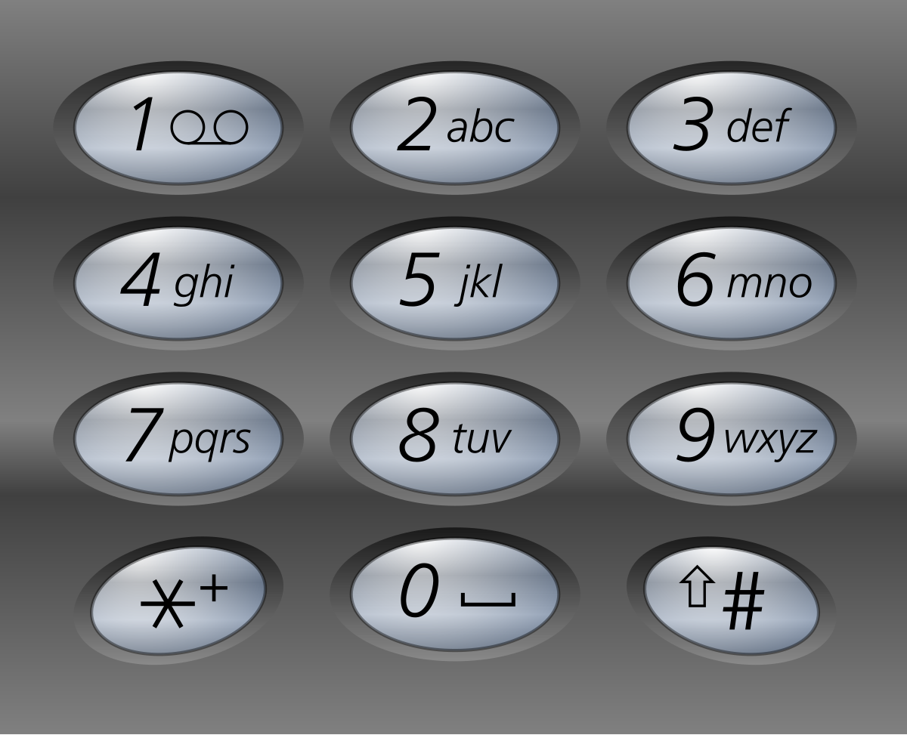

# 电话号码的字母组合
> https://leetcode.cn/problems/letter-combinations-of-a-phone-number/description/

给定一个仅包含数字`2-9`的字符串，返回所有它能表示的字母组合。答案可以按 **任意顺序** 返回。

给出数字到字母的映射如下（与电话按键相同）。注意 1 不对应任何字母。


**示例1**
```
输入：digits = "23"
输出：["ad","ae","af","bd","be","bf","cd","ce","cf"]
```

**示例2**
```
输入：digits = "2"
输出：["a","b","c"]
```

**提示**
- `1 <= digits.length <= 4`
- `digits[i]`是范围`['2', '9']`的一个数字


```python3
class Solution:
    def letterCombinations(self, digits: str) -> List[str]:
        phonemap = {
            "2": "abc",
            "3": "def",
            "4": "ghi",
            "5": "jkl",
            "6": "mno",
            "7": "qprs",
            "8": "tuv",
            "9": "wxyz"
        }
        # 笛卡尔积
        queue = [""]
        for digit in digits:
            queue = [i+j for i in queue for j in phonemap[digit]]
        return queue
```